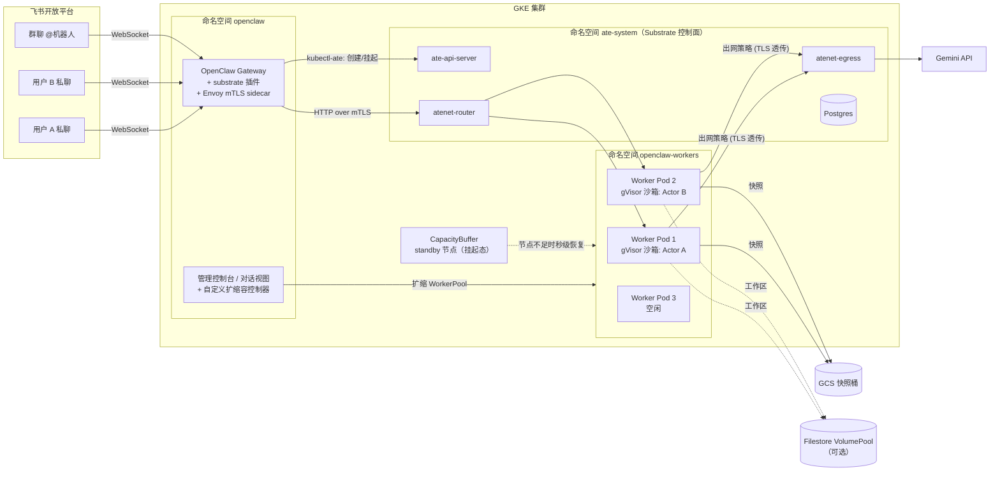
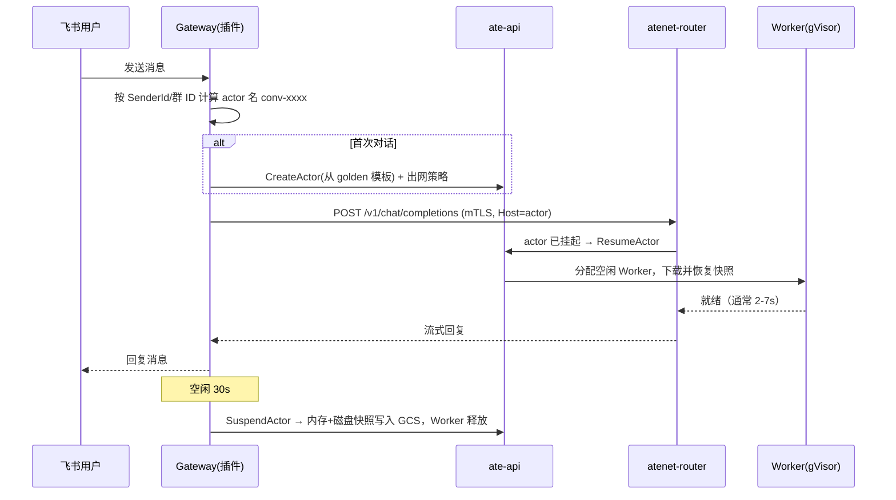
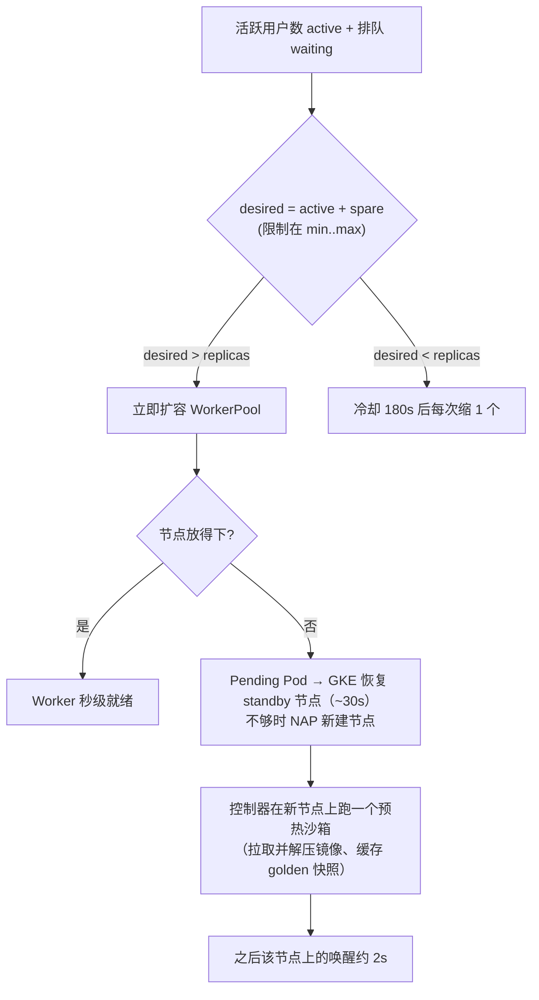

# OpenClaw × Agent Substrate on GKE —— 飞书多用户智能体 POC 搭建指南

> 版本：v1.0（基于 Agent Substrate v1.0.0、OpenClaw 2026.11.2、GKE 1.37 Rapid）
> 适用对象：希望在 GKE 上为**每个终端用户运行一个隔离的 AI 智能体沙箱**，并通过**飞书**对话的团队

---

## 目录

1. [方案概述](#1-方案概述)
2. [架构](#2-架构)
3. [前置条件](#3-前置条件)
4. [第一步：准备工作目录与环境变量](#4-第一步准备工作目录与环境变量)
5. [第二步：创建 GCP 基础设施与 GKE 集群](#5-第二步创建-gcp-基础设施与-gke-集群)
6. [第三步：安装 Agent Substrate](#6-第三步安装-agent-substrate)
7. [第四步：配置智能体存储（Filestore VolumePool / 本地快照）](#7-第四步配置智能体存储)
8. [第五步：创建飞书应用](#8-第五步创建飞书应用)
9. [第六步：构建镜像](#9-第六步构建镜像)
10. [第七步：部署 OpenClaw 网关、模板与控制台](#10-第七步部署-openclaw-网关模板与控制台)
11. [第八步：弹性扩缩容（NAP + ComputeClass + Standby Buffer + 预热）](#11-第八步弹性扩缩容)
12. [验证清单](#12-验证清单)
13. [使用两个界面](#13-使用两个界面)
14. [优化方案汇总](#14-优化方案汇总)
15. [性能参考数据](#15-性能参考数据)
16. [常见问题与排障](#16-常见问题与排障)
17. [生产化建议](#17-生产化建议)
18. [清理环境](#18-清理环境)

---

## 1. 方案概述

### 1.1 目标

| 能力 | 说明 |
|---|---|
| 一人一沙箱 | 每个飞书用户（私聊）或每个飞书群对应一个独立的 OpenClaw 智能体，运行在 gVisor 沙箱中，彼此隔离 |
| 空闲自动挂起 | 对话空闲 30 秒后，沙箱连同**进程内存 + 文件系统**做快照并释放计算资源 |
| 消息自动唤醒 | 用户再次发消息时，从快照恢复，**对话上下文和工作区文件都还在**，通常 2–7 秒 |
| 多用户零配置 | 新用户第一次给机器人发消息时自动创建沙箱，不需要预先登记 |
| 飞书群聊 | 群里 @机器人 即可对话，每个群一个共享的智能体 |
| 弹性扩缩容 | 活跃用户数超过当前 Worker 数时自动扩容 Worker；节点不足时由 GKE Standby Capacity Buffer 秒级提供预热节点 |
| 两个界面 | ① 智能体集群管理控制台；② 终端用户对话视图（可模拟多用户） |

### 1.2 核心思路：网关常驻 + 智能体按需

OpenClaw 被拆成两部分：

- **网关（Gateway，常驻）**：接入飞书 WebSocket，负责会话路由、空闲检测与挂起。很轻，一个 Pod 即可。
- **智能体（Actor，按需）**：真正调用大模型、读写工作区的 OpenClaw 实例。每个会话一个，由 Substrate 在 gVisor 沙箱中运行，空闲即挂起。

这样，1000 个注册用户里只有正在说话的那部分会占用计算资源。Worker（运行沙箱的 Pod）数量只需要覆盖**并发活跃**用户数。

---

## 2. 架构



### 2.1 一条消息的生命周期



### 2.2 组件清单

| 组件 | 来源 | 作用 |
|---|---|---|
| Agent Substrate v1.0.0 | 开源 `github.com/agent-substrate/substrate`，公开镜像 `ghcr.io/agent-substrate/substrate:v1.0.0` | 沙箱生命周期、快照、路由、出网控制 |
| substrate-gke 工具 | 开源 `github.com/ai-on-gke/substrate-gke`（`tools/setup-gcp`、`tools/cleanup-gcp`） | 一键创建 GCP 资源和集群 |
| Filestore CSI（Substrate overlay） | 开源 `kubernetes-sigs/gcp-filestore-csi-driver` 的 `deploy/kubernetes/overlays/substrate` | 每个智能体挂载一块 Filestore VolumePool 卷（可选） |
| OpenClaw 2026.11.2-slim | 公开镜像 `ghcr.io/openclaw/openclaw`（按 digest 固定） | 智能体与网关 |
| POC 代码 | 本仓库 [`openclaw/substrate-poc/`](./substrate-poc/) | 网关插件、镜像构建、部署脚本、控制台、扩缩容控制器 |

---

## 3. 前置条件

### 3.1 GCP

- 一个有 Owner（或同等权限）的 GCP 项目，已绑定结算账号
- 启用 API：`container`、`compute`、`artifactregistry`、`cloudbuild`、`storage`、`iam`、`file`（使用 Filestore 时）
- 配额：所选区域至少 **40 vCPU**（2×n2d-standard-8 系统节点 + 若干 n2d-standard-4 Worker 节点 + 弹性余量）
- 如需 Filestore 存储：在**同一 VPC、同一区域**内已有或可创建 Filestore **VolumePool**

> [!TIP]
> 选机型前先确认区域内库存。POC 期间 `c3-standard-8` / `n2-standard-8` 曾遇到 `ZONE_RESOURCE_POOL_EXHAUSTED`，改用 **n2d** 系列后正常。

### 3.2 本地工具

| 工具 | 版本 |
|---|---|
| gcloud SDK | 最新 |
| kubectl | ≥ 1.33 |
| Go | ≥ 1.25（用于运行 setup 工具和编译 `kubectl-ate`），设置 `GOTOOLCHAIN=auto` |
| git、jq、python3 | 任意近期版本 |
| Docker | 可选（镜像统一用 Cloud Build 构建） |

### 3.3 其他

- **Gemini API Key**（Google AI Studio 或 GCP 控制台中创建）
- **飞书企业自建应用**（第 8 节创建）

---

## 4. 第一步：准备工作目录与环境变量

```bash
export WORK=$HOME/openclaw-poc && mkdir -p $WORK && cd $WORK

# 1) 开源组件
git clone https://github.com/agent-substrate/substrate.git && (cd substrate && git checkout v1.0.0)
git clone https://github.com/ai-on-gke/substrate-gke.git
git clone --depth 1 https://github.com/kubernetes-sigs/gcp-filestore-csi-driver.git   # 使用 Filestore 时

# 2) POC 代码（本仓库 openclaw/substrate-poc/ 目录）
git clone https://github.com/Leisureroad/ai-agent-sandbox-on-gke.git
cp -r ai-agent-sandbox-on-gke/openclaw/substrate-poc openclaw-demo

# 3) 密钥目录（不要提交到任何仓库）
mkdir -p secrets && chmod 700 secrets
echo -n "<你的 Gemini API Key>" > secrets/gemini.key
openssl rand -hex 24 > secrets/gateway.token
touch secrets/feishu-peers.txt                    # 可留空，见 10.3
```

目录结构必须如下，`deploy.sh` 依赖这些相对路径：

```text
$WORK/
├── substrate/                  # Substrate v1.0.0 源码
├── substrate-gke/              # setup-gcp / cleanup-gcp + .ate-dev-env.sh
├── gcp-filestore-csi-driver/   # 可选
├── openclaw-demo/              # POC 代码包
└── secrets/                    # gemini.key, gateway.token, feishu-peers.txt
```

创建环境文件 `substrate-gke/.ate-dev-env.sh`，把 `<...>` 换成你的值：

```bash
#!/usr/bin/env bash
export PATH="$HOME/google-cloud-sdk/bin:$HOME/go/bin:$PATH"
export GOTOOLCHAIN=auto
export PROJECT_ID="<project-id>"
export PROJECT_NUMBER="<project-number>"
export CLOUDSDK_CORE_PROJECT="$PROJECT_ID"

export GCE_REGION=us-central1
export CLUSTER_LOCATION=us-central1-c
export NETWORK=<vpc 名称>             # 使用 Filestore 时须与 VolumePool 同一 VPC
export SUBNETWORK=<子网名称>

export CLUSTER_NAME=openclaw-demo
export CLUSTER_VERSION=1.37
export RELEASE_CHANNEL=rapid
export NODE_POOL_NAME=substrate-node-pool
export NODE_MACHINE_TYPE=n2d-standard-8
export ENABLE_NESTED_VIRTUALIZATION=false
export BOOT_DISK_SIZE_GB=200
export KUBECTL_CONTEXT=

export BUCKET_NAME="snap-openclaw-demo-${PROJECT_ID}"
export SNAPSHOT_LOCATION="gs://${BUCKET_NAME}/"
export SNAPSHOT_TRANSFER_GSA_NAME=ate-snapshot-transfer
export NODE_GSA_NAME=ate-gke-node
export ATELET_SNAPSHOT_ACCESS=false

export ARTIFACT_REGISTRY_REPOSITORY=ate-images
export KO_DOCKER_REPO="${GCE_REGION}-docker.pkg.dev/${PROJECT_ID}/ate-images"
export KO_DEFAULTPLATFORMS=linux/amd64

# 可选：Filestore VolumePool
export VOLUMEPOOL_LOCATION=us-central1
export VOLUMEPOOL_NAME=<volume-pool 名称>

export KUBECONFIG="$HOME/.kube/openclaw-demo.yaml"
```

```bash
source $WORK/substrate-gke/.ate-dev-env.sh
gcloud auth login && gcloud auth application-default login
```

### 4.1 项目相关值全部来自环境变量

代码包中不再写死任何项目 ID 或区域，客户无需修改代码文件：

| 位置 | 取值来源 |
|---|---|
| `deploy/deploy.sh` | 读取 `.ate-dev-env.sh`（可用 `ENV_FILE=/path/to/env.sh` 指定其他文件）中的 `PROJECT_ID`（必填）、`GCE_REGION`（默认 `us-central1`）、`ARTIFACT_REGISTRY_REPOSITORY`（默认 `ate-images`）、`NODE_GSA_NAME`（默认 `ate-gke-node`）；也可直接设置 `NODE_SA` 覆盖节点服务账号 |
| `deploy/computeclass.yaml.tmpl` | `${NODE_SA}` 由 `deploy.sh` 渲染为 `<NODE_GSA_NAME>@<PROJECT_ID>.iam.gserviceaccount.com` |
| `build/cloudbuild-*.yaml` | 镜像地址为 `${_REGION}-docker.pkg.dev/${PROJECT_ID}/${_AR_REPO}`：`PROJECT_ID` 由 Cloud Build 按 `--project` 自动填入；`_REGION`（默认 `us-central1`）和 `_AR_REPO`（默认 `ate-images`）可通过 `--substitutions` 覆盖 |

唯一可能需要按需修改的是智能体人设：`openclaw-demo/build/actor/SOUL.md`、`IDENTITY.md`（默认是中文助手 “Ada”）。

---

## 5. 第二步：创建 GCP 基础设施与 GKE 集群

```bash
cd $WORK/substrate-gke && source .ate-dev-env.sh
go -C tools/setup-gcp run . bootstrap --create-repository 2>&1 | tee ../bootstrap.log
```

该命令会创建：

- GKE Standard 集群（含 Substrate 系统节点池、Postgres 节点池、Worker 节点池）
- GCS 快照桶 `snap-openclaw-demo-<project>`，以及快照传输 GSA
- 节点 GSA `ate-gke-node` 及所需 IAM
- Artifact Registry 仓库 `ate-images`

```bash
gcloud container clusters get-credentials $CLUSTER_NAME --zone $CLUSTER_LOCATION --project $PROJECT_ID
kubectl get nodes -o wide
```

---

## 6. 第三步：安装 Agent Substrate

### 6.1 安装控制面（使用公开发布的 v1.0.0 镜像）

```bash
cd $WORK/substrate
go run ./cmd/ate-setup deploy ate-system \
  --credential-provider='{"name":"k8s.io"}' \
  --ingress-allowed-spiffe-ids=spiffe://cluster.local/ns/openclaw/sa/openclaw-gateway,spiffe://cluster.local/ns/openclaw/sa/openclaw-dashboard,spiffe://cluster.local/ns/ate-system/sa/atenet-client \
  --image-repo ghcr.io/agent-substrate/substrate --image-tag v1.0.0 \
  --sandbox-classes=gvisor --preview=ExternalVolumes

go install ./cmd/kubectl-ate          # 安装 kubectl ate 插件
kubectl -n ate-system get pods        # ate-api-server / ate-controller / atenet-router / atenet-egress 均为 Running
```

参数说明：

- `--ingress-allowed-spiffe-ids`：Substrate v1.0 的 router **只接受 SPIFFE mTLS**，只有白名单里的身份能访问智能体。这里放网关和控制台的 ServiceAccount。
- `--preview=ExternalVolumes`：开启外部卷（Filestore VolumePool），使用本地存储时也建议保留。

### 6.2 调大 router 的请求等待时间（重要）

沙箱冷启动（新节点首次恢复）可能需要 50 秒以上。router 默认只让请求等待 5 秒，超时会直接返回 504。把它调到 180 秒：

```bash
kubectl -n ate-system patch deploy atenet-router --type=json \
  -p='[{"op":"add","path":"/spec/template/spec/containers/0/args/-","value":"--parked-request-budget=180s"}]'
kubectl -n ate-system rollout status deploy/atenet-router
```

> [!WARNING]
> 重新运行 `ate-setup deploy` 会覆盖这个补丁，之后需要再打一次。

---

## 7. 第四步：配置智能体存储

`deploy.sh` 通过 `STORAGE` 变量二选一：

| 选项 | 工作区存在哪里 | 优点 | 适用 |
|---|---|---|---|
| `STORAGE=filestore` | 每个智能体一块 Filestore VolumePool 卷（2 GiB），恢复时挂载、挂起时卸载 | 工作区独立于快照，可共享和备份，容量大 | 生产推荐 |
| `STORAGE=local` | Substrate `durableDir`，随沙箱快照一起存到 GCS | 零依赖、最稳定 | POC / Filestore 不可用时 |

### 7.1 Filestore VolumePool（可选）

```bash
cd $WORK/gcp-filestore-csi-driver/deploy/kubernetes/overlays/substrate
./deploy.sh --project-id $PROJECT_ID \
  --volumepool-location $VOLUMEPOOL_LOCATION \
  --volumepool-name $VOLUMEPOOL_NAME \
  --storageclass-name substrate-volumepool-sc

# 确认 CSI 的 GSA 有 Filestore 编辑权限
G=substrate-filestore-csi@${PROJECT_ID}.iam.gserviceaccount.com
gcloud projects add-iam-policy-binding $PROJECT_ID --member=serviceAccount:$G \
  --role=roles/file.editor --condition=None
kubectl -n gcp-filestore-csi-driver get pods
```

部署前先确认 VolumePool 的底层实例状态是 `READY`：

```bash
gcloud filestore instances list --location $VOLUMEPOOL_LOCATION
```

> [!CAUTION]
> POC 中遇到过 VolumePool 底层实例处于 `REPAIRING` 状态：卷能创建，但 NFS 挂载报 `Connection refused`，智能体无法唤醒。遇到这种情况先用 `STORAGE=local` 继续，待实例恢复后再切换（见 16 节）。

---

## 8. 第五步：创建飞书应用

1. 打开飞书开放平台 → **创建企业自建应用** → 记下 **App ID**（`cli_...`）和 **App Secret**。
2. **添加应用能力** → 机器人。
3. **权限管理**，开通以下权限：
   - `im:message`（获取与发送单聊、群组消息）
   - `im:message.p2p_msg:readonly`（读取用户发给机器人的单聊消息）
   - `im:message.group_at_msg:readonly`（接收群聊中 @机器人 的消息，**群聊必需**）
   - `im:message:send_as_bot`（以应用身份发消息）
   - `contact:user.base:readonly`（可选，用于显示用户名）
4. **事件与回调** → 订阅方式选 **使用长连接接收事件**（WebSocket，不需要公网回调地址）→ 添加事件 `im.message.receive_v1`。
5. **版本管理与发布** → 创建版本并发布。可用范围设为需要试用的人员或部门。
6. 把凭据写入集群（集群在第 10 节部署后存在命名空间；也可以先建好命名空间）：

```bash
kubectl create namespace openclaw --dry-run=client -o yaml | kubectl apply -f -
kubectl -n openclaw create secret generic openclaw-feishu \
  --from-literal=FEISHU_APP_ID=cli_xxxxxxxx \
  --from-literal=FEISHU_APP_SECRET='xxxxxxxx' \
  --dry-run=client -o yaml | kubectl apply -f -
```

> [!IMPORTANT]
> 每次修改权限后，都必须**重新发布版本**才会生效。群聊不响应时，最常见的原因就是缺少 `im:message.group_at_msg:readonly` 或修改后没有重新发布。

---

## 9. 第六步：构建镜像

所有镜像都用 Cloud Build 构建并推送到 Artifact Registry：

```bash
cd $WORK/openclaw-demo
SUBS="_REGION=${GCE_REGION},_AR_REPO=${ARTIFACT_REGISTRY_REPOSITORY}"
gcloud builds submit --project $PROJECT_ID --region $GCE_REGION --substitutions=$SUBS --config build/cloudbuild-demo.yaml .        # gateway + actor
gcloud builds submit --project $PROJECT_ID --region $GCE_REGION --substitutions=$SUBS --config build/cloudbuild-dashboard2.yaml .  # 控制台
```

| 镜像 | 内容 | 关键点 |
|---|---|---|
| `openclaw-actor:demo` | OpenClaw 官方 slim 镜像 + 人设文件 + `entrypoint.sh` | **以 uid 1000 运行**（见 14 节 #3）；首次启动时把人设拷入工作区 |
| `openclaw-gateway:demo` | OpenClaw 官方 slim 镜像 + 编译后的 `substrate` 插件 + `kubectl-ate v1.0.0` | 插件需要 esbuild 预编译成 JS；gateway 与 actor **使用同一个 digest** |
| `openclaw-dashboard:demo` | Node.js 控制台 + 扩缩容控制器 | 见 11.4 |

后续只改了网关插件时，单独构建网关即可：`--config build/cloudbuild-gateway.yaml`。

---

## 10. 第七步：部署 OpenClaw 网关、模板与控制台

### 10.1 一键部署

```bash
cd $WORK/openclaw-demo/deploy
source ../../substrate-gke/.ate-dev-env.sh
# 前提：已按 11.2 开启集群节点自动配置（NAP），ComputeClass 和 CapacityBuffer 依赖它
FEISHU_PEERS=$(paste -sd, ../../secrets/feishu-peers.txt) \
FEISHU_ENABLED=true \
STORAGE=local \
./deploy.sh
```

`deploy.sh` 是幂等的，依次完成：

0. 渲染并应用 Worker 节点类 **ComputeClass** `openclaw-workers`，以及 Standby **CapacityBuffer**（设置 `CAPACITY_BUFFER_ENABLED=false` 可跳过 buffer）
1. 创建命名空间 `openclaw-workers`，部署 **WorkerPool** `openclaw`（默认 3 个 Worker，每个 request 500m/3.5Gi，limit 2CPU/4Gi）
2. 创建命名空间 `openclaw`（打上 `ate.dev/api-access=true` 标签）和密钥
3. 创建 **atespace** `openclaw-demo`，并通过 access policy 把 `editor` 角色授予网关和控制台的 SA
4. 创建 golden **ActorTemplate**（`openclaw-agent-local` 或 `openclaw-agent`）：
   - `wakeupProbe: GET /readyz, timeout 900s`：确保 golden 快照在 OpenClaw 完全启动后才生成
   - `preferredFidelity: SNAPSHOT_FIDELITY_MEMORY`：连同进程内存一起快照，唤醒后直接接着对话
   - 资源：1 vCPU / 2.5 GiB
5. 部署 **Gateway**（OpenClaw + substrate 插件 + Envoy mTLS sidecar）和 **Dashboard**（含 LoadBalancer）

```bash
kubectl -n openclaw rollout status deploy/openclaw-gateway --timeout=400s
kubectl -n openclaw get svc openclaw-dashboard     # 记下 EXTERNAL-IP
kubectl ate get actor-templates -a openclaw-demo
```

> [!NOTE]
> 首次创建模板时，Substrate 会冷启动一个 OpenClaw 来生成 golden 快照，在 gVisor 中约需 **4 分钟**。之后所有新用户都从这个快照派生，不再冷启动。

### 10.2 网关关键配置（`gateway.yaml.tmpl`，已内置）

| 配置 | 值 | 作用 |
|---|---|---|
| `acp.backend` | `substrate` | 对话交给 Substrate 智能体处理 |
| `plugins.entries.substrate.config.idleTimeoutSeconds` | `30` | 空闲多久后挂起（可通过 `IDLE_TIMEOUT_SECONDS` 调整） |
| `session.dmScope` | `per-channel-peer` | 每个飞书用户一个会话 |
| `channels.feishu.connectionMode` | `websocket` | 长连接，不需要公网回调 |
| `channels.feishu.dmPolicy` / `allowFrom` | `open` / `["*"]` | 允许所有可见范围内的用户私聊 |
| `channels.feishu.groupPolicy` / `requireMention` / `groupSessionScope` | `open` / `true` / `group` | 群里 @机器人 才回复，每个群一个智能体 |
| `agents.defaults.model` | `google/gemini-3-flash-preview` | 可改为其他 Gemini 模型 |
| Envoy `x-forwarded-for` | `%ENVIRONMENT(POD_IP)%` | OpenClaw 2026.11 要求代理带客户端归属头，缺失会返回 403 |

### 10.3 多用户路由（零配置）

- **自动路由**：插件在 `reply_dispatch` 阶段做兜底。任何没有显式绑定的飞书私聊（按 `SenderId`）或群聊（按群 ID）都会自动路由到它自己的智能体，名字是 `conv-<hash>`，首次对话时自动创建。
- **显式绑定（可选）**：`secrets/feishu-peers.txt` 中每行一个用户的 `open_id`（`ou_...`），`deploy.sh` 会为其生成 ACP 精确绑定。不需要逐个登记用户，留空即可。

### 10.4 智能体出网

Substrate v1.0 默认**拒绝沙箱的所有出网（包括 DNS）**。插件在创建每个智能体后，立即为它下发出网策略（`deploy/egress-policy.yaml`）：

```yaml
rules:
- tls_passthrough:
    hostnames: [generativelanguage.googleapis.com]
    ports: { numbers: [443] }
```

需要访问其他外部服务（如企业知识库、搜索 API）时，把对应域名加进 `gateway.yaml.tmpl` 中的 `egress-policy.yaml`，然后重新部署。

---

## 11. 第八步：弹性扩缩容

### 11.1 设计



三层分别负责：

| 层 | 机制 | 作用 |
|---|---|---|
| Worker 层 | 自定义控制器（控制台内置）按活跃用户数扩缩 WorkerPool | 秒级响应，决定跑多少个沙箱槽位 |
| 节点层 | GKE NAP + ComputeClass `openclaw-workers` | 按 Pending Pod 自动创建或回收 n2d-standard-4 节点（每节点放 3 个 Worker） |
| 预备层 | GKE **CapacityBuffer（standby）** | 预留一台已初始化并**挂起**的节点：闲置时不收计算费用，需要时约 30 秒恢复 |

> [!NOTE]
> **为什么不用 HPA？** GKE 没有现成的“活跃沙箱数”指标。HPA 方案需要把 Substrate 指标导出到 Cloud Monitoring，再配 Custom Metrics Adapter，链路长、响应慢（通常 30–60s）。POC 采用自定义控制器：直接读取 Substrate 的 actor 状态，在 1 秒内决策，还能顺带做节点预热。生产上两种方式都可以，见第 17 节。

### 11.2 启用节点自动配置（NAP）和 ComputeClass

Standard 集群上，Standby CapacityBuffer **必须由 NAP + ComputeClass 承载**。用普通的手工节点池会报 `NotTriggerScaleUp`。

```bash
gcloud container clusters update $CLUSTER_NAME --zone $CLUSTER_LOCATION \
  --enable-autoprovisioning --min-cpu 0 --max-cpu 96 --min-memory 0 --max-memory 384 \
  --autoprovisioning-service-account ate-gke-node@${PROJECT_ID}.iam.gserviceaccount.com

# ComputeClass 由 deploy.sh 渲染并应用（deploy/computeclass.yaml.tmpl），无需手动 apply
```

`computeclass.yaml.tmpl` 的要点：`machineType: n2d-standard-4`、`nodePoolAutoCreation.enabled: true`、`whenUnsatisfiable: ScaleUpAnyway`。WorkerPool 通过 `nodeSelector: cloud.google.com/compute-class: openclaw-workers` 调度到这类节点。

### 11.3 创建 Standby CapacityBuffer

```bash
# deploy.sh 已自动应用 deploy/capacitybuffer.yaml，这里只需检查状态
kubectl -n openclaw-workers get capacitybuffer openclaw-worker-standby -o yaml
```

- `PodTemplate openclaw-worker-shape`：与 Worker Pod 相同的规格（500m / 3584Mi，带 compute-class 容忍）
- `CapacityBuffer`：`provisioningStrategy: buffer.gke.io/standby-capacity`，`replicas: 3`，即预留一整台 n2d-standard-4 节点

约 5 分钟后，GKE 会创建一台节点，初始化完成后把它**挂起**。可在 Compute Engine 实例列表中看到它处于 `SUSPENDED` 状态。

### 11.4 自定义扩缩容控制器（控制台内置）

控制器代码在 `dashboard2/autoscaler.mjs`，通过 `dashboard.yaml.tmpl` 中的环境变量配置：

| 变量 | 默认值 | 说明 |
|---|---|---|
| `AUTOSCALE` | `true` | 总开关 |
| `AUTOSCALE_MIN` / `AUTOSCALE_MAX` | `3` / `9` | Worker 副本上下限 |
| `AUTOSCALE_SPARE` | `1` | 在活跃数之外额外保留的空闲 Worker，调大可降低新用户的等待 |
| `AUTOSCALE_COOLDOWN_MS` | `180000` | 缩容冷却时间，每次只缩 1 个 |
| `CAPACITY_BUFFER` | `openclaw-worker-standby` | 在控制台展示 buffer 状态 |

**节点预热**：控制器发现新的 Worker 节点后，会在该节点上创建一个 `warmup-*` 临时沙箱，让 atelet 先拉取并解压 OpenClaw 镜像、缓存 golden 快照，完成后立即删除。一次只预热一个节点，每个节点最多重试 3 次。

> [!NOTE]
> 沙箱镜像由 atelet 自己的镜像缓存拉取，不经过 containerd，所以 **GKE Image Streaming 对沙箱冷启动没有加速效果**。控制器层面的预热才是有效手段。

控制台“自动扩缩容”面板可以实时查看 active / waiting / desired / replicas、节点、预热状态和事件流，也可以在线修改上述参数。

---

### 11.5 缩容 / 节点回收时 actor 会不会丢记忆

Worker Pod 被删除（控制器缩容、GKE 回收节点、节点升级、Spot 抢占）时，actor 的结果取决于它当时的状态：

| actor 状态 | 结果 | 记忆 |
|---|---|---|
| `SUSPENDED`（快照已在 GCS） | 不受影响，下次唤醒到任意空闲 Worker | 完整保留 |
| `SUSPENDING`（正在挂起） | Worker 收到 SIGTERM 后会等快照上传完成再退出，实测正常进入 `SUSPENDED` | 完整保留 |
| `RUNNING`（正在对话） | 沙箱被终止，actor 变为 `CRASHED`；下一条消息到来时网关自动 `revert` 到最后一次挂起的快照，再重发消息 | 退回到**上一次挂起时**，只丢本次唤醒后的对话（通常 1–2 轮） |

> [!IMPORTANT]
> 网关必须使用**同步挂起**（`kubectl ate suspend --mode=sync`，代码包已内置）。Substrate 默认是异步挂起：快照先留在节点本地，稍后才上传 GCS。如果节点在上传前被回收，最新快照就丢了，唤醒时会 `CRASHED`，`revert` 也只能退回更早的快照。POC 中真实发生过一次：一个飞书用户的 actor 被退回到了 golden 初始状态。同步挂起每次多花约 10–15 秒，但发生在用户空闲之后，用户感知不到。

实测（POC）：

- 同步挂起后，快照立即是 `durableSnapshot: COMPLETED`。
- 挂起过程中删除 Worker：actor 正常进入 `SUSPENDED`，记忆完整。
- 运行中删除 Worker：actor 变为 `CRASHED`。下一条消息触发网关自动 `RevertActor`，19 秒后正常回复，保留了上次挂起前的记忆，丢失了崩溃前那一轮的新信息。

可选的进一步加固（POC 未实现）：控制器给有 actor 在运行的 Worker Pod 打上 `cluster-autoscaler.kubernetes.io/safe-to-evict: "false"`，让 GKE 只回收全空闲的节点；缩容前先主动挂起目标 Worker 上的 actor。

---

## 12. 验证清单

| # | 验证项 | 操作 | 预期 |
|---|---|---|---|
| 1 | 控制面健康 | `kubectl -n ate-system get pods` | 全部 Running |
| 2 | Worker 就绪 | `kubectl ate get workers` | 3 个 Worker 空闲 |
| 3 | 模板就绪 | `kubectl ate get actor-templates -a openclaw-demo` | golden 快照已生成 |
| 4 | 网页对话 | 打开 `http://<EXTERNAL-IP>/chat`，以“张三”身份发消息 | 首次约 50s，之后几秒内回复 |
| 5 | 自动挂起 | 等待 30s，查看控制台 | actor 变为 `SUSPENDED`，Worker 被释放 |
| 6 | 唤醒恢复上下文 | 问“我刚才说了什么？” | 2–7s 回复，内容连贯 |
| 7 | 工作区持久化 | 让智能体写文件 `note.txt`，挂起后再让它读出来 | 内容一致 |
| 8 | 飞书私聊 | 在飞书中搜索机器人并私聊 | 收到以 `🤖` 开头的回复 |
| 9 | 新用户零配置 | 让一位没有登记的同事私聊机器人 | 自动创建新的 `conv-*` 沙箱并回复 |
| 10 | 飞书群聊 | 把机器人拉进群，发 `@机器人 你好` | 群内回复；不 @ 时不回复 |
| 11 | 并发扩容 | 在对话视图同时让 7 个模拟用户发消息 | Worker 3→7，节点增加，standby 节点恢复 |
| 12 | 缩容 | 停止对话 | 冷却 180s 后每次缩 1 个 Worker |
| 13 | 删除后自愈 | 在控制台删除某用户的 actor，该用户再发消息 | 自动重建并回复（之前的记忆会丢失） |
| 14 | 挂起持久化 | 对话后等待 30s，执行 `kubectl ate get actor <name> -a openclaw-demo -o json \| jq '.status.snapshots'` | 最新快照的 `durableSnapshot.state` 为 `COMPLETED` |
| 15 | 崩溃自愈 | actor 处于 RUNNING 时删除它的 Worker Pod，等状态变为 `CRASHED` 后再发消息 | 网关自动 revert 并回复，保留上次挂起前的记忆 |

压测示例（7 个并发用户）：

```bash
IP=<EXTERNAL-IP>
for u in zhangsan:张三 lisi:李四 wangwu:王五 zhaoliu:赵六 sunqi:孙七 zhouba:周八 wujiu:吴九; do
  id=${u%%:*}; name=${u#*:}
  ( t0=$(date +%s)
    curl -s -m 300 -X POST http://$IP/api/chat -H 'content-type: application/json' \
      -d "{\"user\":\"$id\",\"displayName\":\"$name\",\"text\":\"你好，用两句话介绍一下你自己\"}" >/dev/null
    echo "$name 用时 $(( $(date +%s)-t0 ))s" ) &
done; wait
curl -s http://$IP/api/state | jq '.autoscaler | {active, waiting, desired, replicas, readyReplicas}'
```

---

## 13. 使用两个界面

### 界面一：管理控制台 `http://<EXTERNAL-IP>/`

- **智能体列表**：状态（RUNNING / SUSPENDED / RESUMING）、所在 Worker 与节点、快照代数、所属飞书用户
- **Worker 池**：每个 Worker 当前承载哪个智能体，挂起后释放情况一目了然
- **操作**：挂起、删除、查看日志、全部挂起
- **自动扩缩容面板**：参数、节点、standby buffer、预热进度、事件时间线
- **唤醒耗时分解**：download / oci_unpack / restore 等各阶段耗时

> [!WARNING]
> “删除”会同时删掉该用户的快照和工作区，用户再发消息时会作为新用户重新开始。只想释放资源时请用“挂起”。

### 界面二：终端用户对话视图 `http://<EXTERNAL-IP>/chat`

- 以飞书风格展示每个用户的对话，包含真实飞书用户和网页模拟用户
- 可以新增模拟用户（如张三、李四），无需飞书账号即可演示多用户并发
- 每条回复显示首字节延迟，并标注本次是热回复还是挂起后唤醒

> [!CAUTION]
> 控制台的 LoadBalancer 默认对 `0.0.0.0/0` 开放。请在部署时用 `DASHBOARD_SOURCE_RANGES='["<你的办公网段>/32"]'` 限制访问来源。

---

## 14. 优化方案汇总

下表汇总了 POC 过程中遇到的全部问题及最终方案，可以直接作为实施检查表。

### 14.1 稳定性与正确性

| # | 问题 / 现象 | 根因 | 方案（已内置于代码包） |
|---|---|---|---|
| 1 | 智能体无法访问 Gemini，DNS 也解析失败 | Substrate v1.0 默认拒绝沙箱的所有出网 | 插件创建 actor 后立即下发**单 actor 出网策略**（TLS 透传 `generativelanguage.googleapis.com:443`） |
| 2 | 网关直连 actor 失败 | router 只接受 SPIFFE mTLS | 网关 Pod 加 **Envoy sidecar**，使用 Substrate 签发的证书发起 mTLS；把网关和控制台 SA 加入 `--ingress-allowed-spiffe-ids` |
| 3 | golden 快照崩溃：`runsc checkpoint exit 128 / no checkpointable filesystems` | 沙箱内去掉了 capabilities，root 没有 `DAC_OVERRIDE`，读取 node 用户的文件时报 EACCES | actor 镜像改为 **`USER 1000`** 运行 |
| 4 | 新用户第一条消息返回 503 | golden 快照抓在 OpenClaw 启动到一半的时候（默认只预热 20s，而 gVisor 中冷启动约 240s） | ActorTemplate 加 **`wakeupProbe: /readyz`，超时 900s** |
| 5 | 返回 403 `proxy_attribution_required` | OpenClaw 2026.11 要求代理请求带 `X-Forwarded-For` | Envoy 注入 `x-forwarded-for: <网关 Pod IP>`；actor 的 `trustedProxies` 设为 `169.254.0.0/16` |
| 6 | 飞书插件安装失败 | `/tmp` emptyDir 权限 2777 且没有 sticky 位 | 去掉 tmp emptyDir，init 容器使用 `readOnlyRootFilesystem: false` 并自建临时目录 |
| 7 | 未登记的飞书用户收到 “Couldn't sign in to the AI service” | OpenClaw ACP 绑定只匹配精确 peer id，通配符 `*` 不生效，消息落到了没有 Key 的网关主 agent | 插件在 `reply_dispatch` 中**自动路由兜底**：按私聊 SenderId / 群 ID 自动路由到独立 actor |
| 8 | 群消息被丢弃 `groupPolicy=disabled` | 默认关闭群聊 | `groupPolicy: open` + `requireMention: true` + `groupSessionScope: group`，并在飞书开通 `im:message.group_at_msg:readonly` |
| 9 | ActorTemplate 无法引用 K8s Secret | v1.0 的模板 env 不支持 `secretKeyRef` | 由 `deploy.sh` 渲染为字面值后创建，**渲染出的文件不落盘、不提交** |
| 10 | 控制台删除 actor 后，该用户一直报 “⚠️ This model was not found” | 网关缓存了“actor 已存在”，router 对已删除的 actor 返回 404 | 插件遇到 404 时清除缓存，**从 golden 模板自动重建并重试一次**；空闲挂起器遇到 NotFound 时停止跟踪 |
| 11 | 冷节点上的首个请求返回 504 | router 默认只让请求等待 5s（POC 中试过 90s 仍不够），而冷节点恢复需要约 47s | `atenet-router --parked-request-budget=180s`，并配合节点预热 |
| 12 | 节点被回收后，用户收到 “The AI service is temporarily overloaded”，且记忆丢失 | 默认**异步挂起**，快照还在节点本地没上传，节点就被 GKE 回收；唤醒时找不到快照，actor 变为 `CRASHED`，router 返回 503 | 网关改用**同步挂起** `--mode=sync`，快照写入 GCS 后才算挂起完成 |
| 13 | actor 运行中 Worker 被删除，之后一直报 503 | actor 进入 `CRASHED`，没有任何组件处理 | 网关收到 503 时先确认状态是 `CRASHED`，再自动 `RevertActor` 到最后一个已上传的快照，然后重发消息；空闲挂起器遇到 `CRASHED` 时停止重试 |

### 14.2 性能与弹性

| # | 优化 | 效果 |
|---|---|---|
| 14 | **内存级快照**（`SNAPSHOT_FIDELITY_MEMORY`） | 唤醒后进程直接续跑，不重启 OpenClaw，热节点唤醒 1.4–7s（冷启动约 240s） |
| 15 | **Worker 数少于用户数**，空闲 30s 自动挂起并让出 Worker | 3 个 Worker 即可服务数十个注册用户，资源按并发计费 |
| 16 | **自定义扩缩容控制器**（active + spare，冷却 180s） | 检测到并发上升后 1 秒内扩容；缩容平滑，不会来回抖动 |
| 17 | **GKE Standby CapacityBuffer**（NAP + ComputeClass） | 预留节点挂起时不收计算费用，恢复约 30s，比新建节点（2–3 分钟）快得多 |
| 18 | **新节点预热**（warmup actor） | 把首个用户承担的约 45s 镜像解压提前完成；预热后该节点唤醒约 2s |
| 19 | Worker 规格对齐节点（request 500m / 3.5Gi，n2d-standard-4 放 3 个） | 装箱率高，buffer 的一个“chunk”正好对应一个 Worker |
| 20 | 评估过 GKE Image Streaming | **对沙箱无效**：atelet 自带镜像缓存，不走 containerd。仅对普通 Pod 镜像有用 |
| 21 | 可选：`AUTOSCALE_SPARE=2` | 新用户在扩容瞬间不再等待节点（代价是多一个常驻空闲 Worker） |

---

## 15. 性能参考数据

POC 实测数据（gVisor，n2d-standard-4 Worker 节点，Gemini Flash 模型）：

| 场景 | 端到端耗时 | 说明 |
|---|---|---|
| golden 模板首次生成 | ~240s | 只发生一次 |
| 新用户首次对话（热节点） | ~50s | 创建 actor + 出网策略 + 从 golden 恢复 + 首次模型调用 |
| 老用户唤醒（热节点） | **5–6s**（其中恢复 1.4–7s） | 下载快照约 1–2s，恢复约 2s |
| 老用户唤醒（未预热的新节点） | ~60s | download ~10s + **oci_unpack ~45s** + restore ~2s |
| 沙箱挂起（同步，快照写入 GCS） | ~15s | 用户空闲后在后台执行，用户无感知 |
| 崩溃后自动恢复（revert + 唤醒 + 回复） | ~19s | |
| Worker 扩容决策 | < 1s | 3→7 |
| standby 节点恢复 | ~30s | 挂起 → Ready |
| 新节点预热 | ~48s | 预热完成后该节点唤醒约 2s |
| 4 用户并发 | 全部 5–20s | Worker 3→5 |
| 7 用户并发 | 老用户 5–6s，新用户 56–59s | 新用户的主要耗时在等待第 7 个 Worker 所需的新节点 |

---

## 16. 常见问题与排障

| 现象 | 排查命令 | 处理 |
|---|---|---|
| 飞书 @机器人 没反应 | `kubectl -n openclaw logs deploy/openclaw-gateway -c gateway \| grep feishu` | 没有任何 received 日志：检查权限、事件订阅（长连接 + `im.message.receive_v1`）和版本是否已发布；日志里有 `groupPolicy=disabled`：检查群聊配置 |
| 回复 “Couldn't sign in to the AI service” | 网关日志中查看 `dispatching to agent` 的 session | 应该是 `acp:...` 形式。如果不是，确认插件版本包含自动路由兜底 |
| 回复 “The AI service is temporarily overloaded” | `kubectl ate get actors -a openclaw-demo` 查看是否为 `CRASHED` | actor 崩溃了。新版网关会自动 revert；也可以手动执行 `kubectl ate revert actor <name> -a openclaw-demo` |
| 回复 “⚠️ This model was not found” | `kubectl ate get actors -a openclaw-demo` | actor 被删除了。确认网关已更新到包含 404 自愈的版本，用户再发一次即可 |
| 504 / 等很久没回复 | `kubectl -n ate-system logs deploy/atenet-router` | 确认 `--parked-request-budget=180s`；查看是否有 Worker 空闲（`kubectl ate get workers`） |
| actor 卡在 RESUMING | `kubectl ate logs actor <name> -a openclaw-demo` | 使用 Filestore 时检查 VolumePool 实例状态和 NFS 挂载 |
| 503 首次请求 | 查看模板的 `wakeupProbe` | 模板不可修改，需要新建模板（改名）后重新部署 |
| CapacityBuffer 不生效（`NotTriggerScaleUp`） | `kubectl -n openclaw-workers get events --field-selector involvedObject.kind=CapacityBuffer` | 确认已开启 NAP，且 PodTemplate 和 WorkerPool 都选择了 ComputeClass |
| 扩容后 Worker 一直 Pending | `kubectl -n openclaw-workers describe pod <worker>` | 检查 NAP 的 CPU / 内存上限和区域配额 |
| 切换回 Filestore | — | VolumePool 实例 `READY` 后执行 `STORAGE=filestore ./deploy.sh`（会创建新模板 `openclaw-agent`，已有用户仍沿用旧模板，新用户才会用新模板） |

常用命令：

```bash
kubectl ate get actors -a openclaw-demo               # 所有智能体
kubectl ate get workers                               # Worker 占用情况
kubectl ate suspend actor <name> -a openclaw-demo     # 手动挂起
kubectl ate logs actor <name> -a openclaw-demo        # 沙箱内日志
curl -s http://<EXTERNAL-IP>/api/state | jq .autoscaler
```

---

## 17. 生产化建议

| 方面 | POC 做法 | 生产建议 |
|---|---|---|
| 密钥 | Gemini Key 以字面值写入模板 | 使用 Vertex AI + Workload Identity，免 Key；或用 Secret Manager 加注入代理 |
| 飞书凭据 | K8s Secret | Secret Manager + External Secrets；**POC 结束后重置 App Secret** |
| 控制台暴露 | 公网 LB | Identity-Aware Proxy 或内网 LB，加上 `DASHBOARD_SOURCE_RANGES` |
| 网关高可用 | 单副本 + Recreate | 飞书 WebSocket 同一时间只能有一个消费者，可做主备；会话状态放到 PVC 或外部存储 |
| 存储 | `local` | Filestore VolumePool，并配置备份 |
| 扩缩容 | 自定义控制器（状态在内存中，重启会丢失预热记录） | 控制器状态持久化；或将 Substrate 指标导出到 Cloud Monitoring，用 HPA 和 Custom Metrics Adapter |
| 新用户延迟 | `spare=1` | 按峰值并发设置 `spare` 和 CapacityBuffer 的 `replicas`；按时段预扩容 |
| 版本 | 镜像按 digest 固定 | 保持 gateway 与 actor 使用同一 OpenClaw digest，`kubectl-ate` 与控制面版本一致 |
| 可观测性 | 控制台 | 接入 Substrate 的 Prometheus 指标和 Cloud Logging，并设置告警（唤醒 P95、504 比例、Worker 饱和度） |
| 出网 | 只放通 Gemini | 按业务最小化放通，所有外部访问都走 egress 策略 |

---

## 18. 清理环境

```bash
cd $WORK/substrate-gke && source .ate-dev-env.sh
kubectl delete -f $WORK/openclaw-demo/deploy/capacitybuffer.yaml --ignore-not-found
kubectl delete computeclass openclaw-workers --ignore-not-found
# 删除集群（含其上所有工作负载）、快照桶、GSA、IAM 绑定等；脚本会先要求确认
./tools/cleanup-gcp --project $PROJECT_ID --cluster $CLUSTER_NAME --location $CLUSTER_LOCATION --bucket $BUCKET_NAME
```

另外需要手动处理：

- 删除或重置飞书应用的 App Secret
- 删除 Gemini API Key
- 如创建过专用的 Filestore VolumePool，按需删除

---

### 附：代码包结构

```text
openclaw-demo/
├── extensions/substrate/       # 网关插件
│   ├── index.ts                #   插件入口：ACP 后端、自动路由兜底、observer 服务、网页对话
│   ├── acp-runtime.ts          #   把对话转发给 actor（mTLS），404 时自动重建
│   ├── actor-provisioner.ts    #   幂等创建 actor（singleflight + 缓存 + forget）
│   ├── kubectl-ate-client.ts   #   调用 kubectl-ate：创建/挂起/删除 actor，下发出网策略
│   ├── idle-suspender.ts       #   空闲检测与挂起
│   └── observer.ts             #   对话与耗时观测，供控制台读取
├── build/
│   ├── actor.Dockerfile, actor/   # 智能体镜像与人设
│   ├── gateway.Dockerfile         # 网关镜像
│   └── cloudbuild-*.yaml
├── dashboard2/                 # 控制台、对话视图、扩缩容控制器
└── deploy/
    ├── deploy.sh               # 一键部署
    ├── workerpool.yaml.tmpl, actortemplate.yaml.tmpl, gateway.yaml.tmpl, dashboard.yaml.tmpl
    ├── egress-policy.yaml
    ├── computeclass.yaml.tmpl
    └── capacitybuffer.yaml
```
